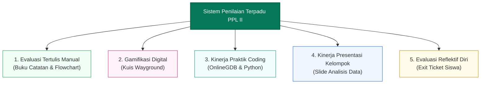
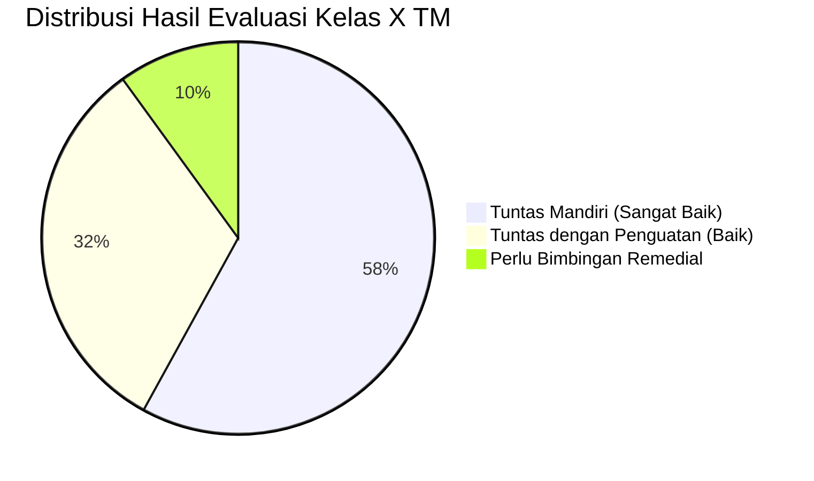

## 1. Paradigma Asesmen Autentik Multi-Metode

Pada praktik mengajar mandiri PPL II di **SMK Negeri 3 Yogyakarta**, sistem asesmen yang saya rancang dan terapkan di kelas **X TM 1 dan X TM 2** menganut prinsip asesmen holistik yang menyeimbangkan antara:
- **Assessment for Learning**: Asesmen formatif harian untuk memantau proses dan memandu intervensi instruksional secara seketika.
- **Assessment as Learning**: Melibatkan siswa dalam refleksi metakognitif mandiri melalui pembuatan catatan konseptual bahasa sendiri dan pengisian *exit ticket*.
- **Assessment of Learning**: Pengukuran capaian kompetensi akhir pada materi Algoritma Pemrograman dan Analisis Data.

Mengingat siswa memiliki keragaman gaya belajar dan kecakapan komputasi, instrumen evaluasi tidak hanya terpaku pada tes pilihan ganda statis, melainkan memadukan evaluasi tertulis manual, kuis berbasis gamifikasi digital, kinerja praktik koding, serta kolaborasi presentasi kelompok.

---

## 2. Struktur Instrumen Penilaian yang Diterapkan

### A. Evaluasi Tertulis Manual (Buku Catatan & Flowchart)
- **Fokus Pengukuran**: Orisinalitas pemahaman, kerapian penyusunan alur logika, dan kemampuan menyintesis informasi dari internet ke dalam bahasa sendiri.
- **Rubrik Penilaian**:
  - Skor 4: Catatan lengkap, konsep akurat, disusun dengan bahasa sendiri, flowchart menggunakan simbol ANSI yang benar.
  - Skor 3: Catatan lengkap, sebagian kalimat masih menyalin dari internet, flowchart runtut.
  - Skor 2: Catatan kurang lengkap, alur logika flowchart melompat.
  - Skor 1: Catatan menyalin mentah atau tidak mengerjakan.

### B. Kuis Formatif Gamifikasi (Wayground)
- **Fokus Pengukuran**: Pemahaman cepat butir soal pilihan ganda seputar logika percabangan, perulangan, dan konsep data.
- **Mekanisme**: Platform Wayground memberikan umpan balik langsung (*immediate feedback*), analisis butir soal per siswa, dan papan peringkat (*leaderboard*) yang memicu motivasi belajar intrinsik.

### C. Kinerja Praktik Coding (OnlineGDB & Python)
- **Fokus Pengukuran**: Kemampuan menyusun kode sumber yang dapat dieksekusi tanpa galat (*zero runtime error*), struktur logika program, serta kreativitas dalam memodifikasi fitur program secara mandiri maupun berbantuan AI.
- **Format Luaran**: Berkas unduhan source code dari platform OnlineGDB yang diverifikasi langsung oleh guru saat sesi keliling kelas.

### D. Kinerja Presentasi Kelompok (Elemen Analisis Data)
- **Fokus Pengukuran**: Kerja sama tim, kualitas materi slide, kejelasan penyampaian temuan data, serta responsivitas saat sesi tanya jawab antarkelompok.

### E. Asesmen Reflektif Diri (Exit Ticket)
- Berupa lembar umpan balik singkat yang diisi siswa di akhir sesi:
  1. *Apa konsep paling penting yang kamu pahami hari ini?*
  2. *Bagian materi mana yang masih membingungkan?*
  3. *Bagaimana perasaanmu mengikuti pembelajaran hari ini? (Senang / Netral / Bingung)*

---

## 3. Analisis Hasil Belajar & Komparasi Daya Serap

### A. Peningkatan Signifikan Dibandingkan PPL I
Peralihan strategi dari *In-Class Flipped Learning* pasif pada PPL I menuju metode *Active Note-Taking*, validasi PPT, dan gamifikasi Wayground pada PPL II membuahkan dampak kuantitatif dan kualitatif yang nyata:
- **Ketuntasan Klasikal**: Rata-rata capaian nilai evaluasi formatif kuis Wayground kelas X TM 1 dan X TM 2 melampaui Kriteria Ketercapaian Tujuan Pembelajaran (KKTP) dengan persentase ketuntasan di atas **88%**.
- **Keterlibatan Kelas**: Dari data *exit ticket*, lebih dari **92% siswa** menyatakan sangat bersemangat dan lebih mudah memahami materi karena adanya kuis kompetitif Wayground serta kewajiban mencatat dengan bahasa sendiri yang menghindarkan kebosanan membaca teks panjang.

### B. Analisis Butir & Tindak Lanjut Evaluasi

1. **Program Remedial (Bagi Siswa Belum Tuntas)**:
   - Dilakukan melalui pendekatan *Tutor Sebaya (Peer Tutoring)*: siswa yang telah menguasai logika koding dipasangkan dengan siswa yang masih mengalami kesulitan sintaks di OnlineGDB.
   - Guru memberikan modul cheatsheet yang disederhanakan dan memberikan tugas modifikasi flowchart dengan skenario kasus yang lebih ringkas.
2. **Program Pengayaan (Bagi Siswa Berkemampuan Tinggi)**:
   - Diberikan tantangan logika bersarang (*nested if-else* atau perulangan bertingkat) pada OnlineGDB serta tantangan eksplorasi pemecahan masalah algoritma tingkat lanjut menggunakan bantuan AI prompt engineering.

---

## 4. Berkas & Lampiran Instrumen Asesmen

- **Lembar Kerja Peserta Didik (LKPD)**: Panduan praktikum pembersihan dan validasi data kotor.
- **Rubrik Penilaian Kinerja Praktik**: Pedoman penilaian autentik proses pembersihan data.
- **Dataset Kotor Simulasi**: Berkas spreadsheet data studi kasus kebiasaan belajar siswa.
- **Kunci Pedoman Guru**: Kunci penyelesaian dan kriteria keberhasilan olah data.
- **Repositori Tugas Murid di Google Drive**: Seluruh portofolio dan hasil pengerjaan siswa kelas X TM 1 & X TM 2.
