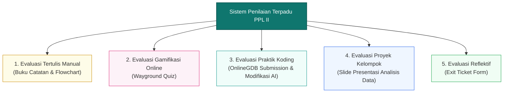
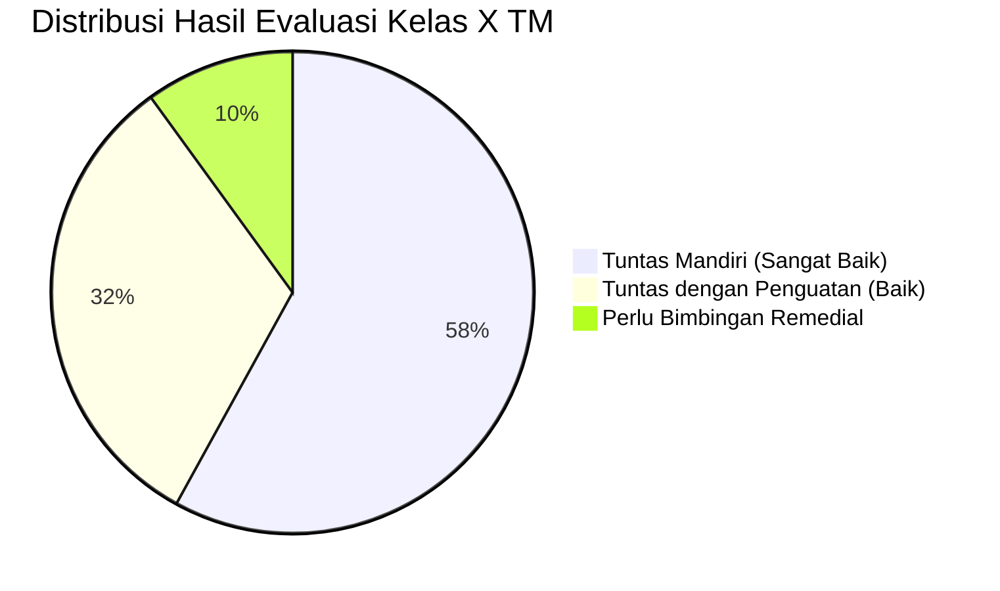

## 1. Paradigma Asesmen Autentik Multi-Metode

Pada praktik mengajar mandiri PPL II di **SMK Negeri 3 Yogyakarta**, sistem asesmen yang saya rancang dan terapkan di kelas **X TM 1 dan X TM 2** menganut prinsip asesmen holistik yang menyeimbangkan antara:
- **Assessment for Learning**: Asesmen formatif harian untuk memantau proses dan memandu intervensi instruksional secara seketika.
- **Assessment as Learning**: Melibatkan siswa dalam refleksi metakognitif mandiri melalui pembuatan catatan konseptual bahasa sendiri dan pengisian *exit ticket*.
- **Assessment of Learning**: Pengukuran capaian kompetensi akhir pada materi Algoritma Pemrograman dan Analisis Data.

Mengingat siswa memiliki keragaman gaya belajar dan kecakapan komputasi, instrumen evaluasi tidak hanya terpaku pada tes pilihan ganda statis, melainkan memadukan evaluasi tertulis manual, kuis berbasis gamifikasi digital, kinerja praktik koding, serta kolaborasi presentasi kelompok.

---

## 2. Struktur Instrumen Penilaian yang Diterapkan

### A. Asesmen Tertulis Manual (Buku Catatan & Flowchart)
- **Rubrik Penilaian Catatan Siswa**:
  - *Orisinalitas Bahasa*: Menilai kemampuan siswa merangkum materi peramban menggunakan kalimat sendiri (skor maksimal diberikan jika tidak ada kalimat yang sekadar menyalin mentah-mentah dari web).
  - *Kelengkapan Poin Kunci*: Memastikan poin-poin materi esensial tercakup secara sistematis.
  - *Kerapian & Keterbacaan*: Menilai struktur hierarki tulisan dan diagram logika sederhana.
- **Pengerjaan Flowchart Manual**:
  - Siswa menggambar diagram alur logika algoritma di buku catatan dengan simbol ANSI standar (Terminator, Input/Output, Process, Decision, Flowline). Menilai kebenaran alur logika sebelum diimplementasikan ke dalam program komputer.

### B. Asesmen Gamifikasi Digital (Platform Wayground)
- **Karakteristik Soal**: Butir soal pilihan ganda konseptual dan studi kasus algoritma tingkat tinggi (HOTS) yang disajikan dengan batasan waktu dinamis.
- **Fungsi Analitik**: Platform Wayground menghasilkan data statistik langsung:
  - Sebaran skor kelas X TM 1 dan X TM 2 secara real-time.
  - Identifikasi butir soal dengan persentase kesalahan tertinggi (*item difficulty analysis*) untuk langsung dibahas dan diklarifikasi bersama di kelas.

### C. Asesmen Kinerja Praktik Koding (OnlineGDB Submission)
- **Mekanisme Pengumpulan**: Siswa mengeksekusi program di IDE web OnlineGDB, menguji jalannya kode, lalu mengunduh berkas sumber kode (*source code*) untuk dinilai.
- **Kriteria Penilaian Kinerja**:
  1. *Fungsionalitas Program*: Program dapat dikompilasi (*compile*) tanpa galat sintaks dan menghasilkan keluaran (*output*) yang sesuai spesifikasi persoalan.
  2. *Kreativitas Modifikasi Logika*: Siswa diberi kebebasan memodifikasi variabel, pesan interaktif, atau alur percabangan program.
  3. *Eksplorasi Berbantukan AI*: Kemampuan siswa memanfaatkan prompt kecerdasan artifisial untuk memperkaya fungsionalitas program secara etis dan bertanggung jawab.

### D. Asesmen Kolaboratif (Slide Presentasi Analisis Data)
- **Tingkatan Progresi**: Pada materi Analisis Data, proses pencarian ditingkatkan dari penugasan individu menjadi **penugasan investigasi kelompok**.
- **Rubrik Penilaian Presentasi**:
  - *Kualitas Slide*: Kerapian visual, kesesuaian data yang dihimpun, dan kejelasan alur informasi.
  - *Penyampaian & Kerja Sama*: Keterlibatan seluruh anggota kelompok saat berbicara di depan kelas.
  - *Kecakapan Diskusi*: Kemampuan merespons tanggapan dan pertanyaan dari kelompok audiens secara kritis dan santun.

### E. Asesmen Reflektif Diri (Exit Ticket)
- Berupa lembar umpan balik singkat yang diisi siswa di akhir sesi:
  1. *Apa konsep paling penting yang kamu pahami hari ini?*
  2. *Bagian materi mana yang masih membingungkan?*
  3. *Bagaimana perasaanmu mengikuti pembelajaran hari ini? (Senang / Netral / Bingung)*

---

## 3. Analisis Hasil Belajar & Komparasi Daya Serap

### A. Peningkatan Signifikan Dibandingkan PPL I
Peralihan strategi dari *In-Class Flipped Learning* pasif pada PPL I menuju metode *Active Note-Taking*, validasi PPT, dan gamifikasi Wayground pada PPL II membuahkan dampak kuantitatif dan kualitatif yang nyata:
- **Ketuntasan Klasikal**: Rata-rata capaian nilai evaluasi formatif kuis Wayground kelas X TM 1 dan X TM 2 melampaui Kriteria Ketercapaian Tujuan Pembelajaran (KKTP) dengan persentase ketuntasan di atas **88%**.
- **Keterlibatan Kelas**: Dari data *exit ticket*, lebih dari **92% siswa** menyatakan sangat bersemangat dan lebih mudah memahami materi karena adanya kuis kompetitif Wayground serta kewajiban mencatat dengan bahasa sendiri yang menghindarkan kebosanan membaca teks panjang.

### B. Analisis Butir & Tindak Lanjut Evaluasi

1. **Program Remedial (Bagi Siswa Belum Tuntas)**:
   - Dilakukan melalui pendekatan *Tutor Sebaya (Peer Tutoring)*: siswa yang telah menguasai logika koding dipasangkan dengan siswa yang masih mengalami kesulitan sintaks di OnlineGDB.
   - Guru memberikan modul cheatsheet yang disederhanakan dan memberikan tugas modifikasi flowchart dengan skenario kasus yang lebih ringkas.
2. **Program Pengayaan (Bagi Siswa Berkemampuan Tinggi)**:
   - Diberikan tantangan logika bersarang (*nested if-else* atau perulangan bertingkat) pada OnlineGDB serta tantangan eksplorasi pemecahan masalah algoritma tingkat lanjut menggunakan bantuan AI prompt engineering.

---

## 4. Berkas & Lampiran Instrumen Asesmen

- Kisi-kisi Asesmen Formatif & Bank Soal Pilihan Ganda Wayground.
- Rubrik Penilaian Kinerja Koding Praktik OnlineGDB dan Flowchart.
- Rubrik Penilaian Slide & Unjuk Kerja Presentasi Kelompok Analisis Data.
- Rekapitulasi Tanggapan Exit Ticket Siswa Kelas X TM 1 dan X TM 2.
- Tabel Rekapitulasi Ketuntasan Belajar & Rencana Program Remedial-Pengayaan.
