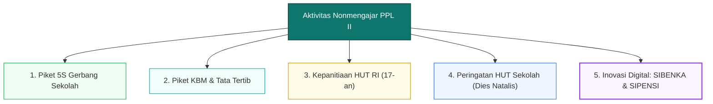

## 1. Integrasi Holistik dalam Ekosistem Satuan Pendidikan

Bagi seorang calon pendidik profesional, kompetensi sosial dan kepribadian tidak hanya diuji di dalam laboratorium komputer atau ruang kelas formal. Keterlibatan aktif dalam denyut kehidupan sekolah mitra—mulai dari pelayanan piket, penegakan budaya disiplin positif, peringatan hari besar, hingga inovasi sistem informasi—merupakan wujud dedikasi nyata dalam membangun ekosistem pendidikan yang unggul.

Selama menjalani masa PPL II di **SMK Negeri 3 Yogyakarta (Skagata)**, saya mengintegrasikan diri secara penuh dalam berbagai agenda nonmengajar struktural maupun inisiatif mandiri berbasis kompetensi teknologi.

---

## 2. Rincian Pelaksanaan 5 Pilar Aktivitas Nonmengajar

### A. Piket 5S (Senyum, Salam, Sapa, Sopan, Santun) di Gerbang Sekolah
- **Fokus Kegiatan**: Berjaga di gerbang utama sekolah setiap pagi sebelum bel masuk berbunyi untuk menyambut kedatangan peserta didik, guru, dan tenaga kependidikan.
- **Implementasi Nilai**: Memeriksa kerapian seragam, ketertiban pemakaian atribut sekolah kejuruan, helm standar berkendara, serta mempraktikkan budaya sapaan hangat. Kegiatan ini merefleksikan nilai-nilai kesantunan Melayu dan etos kerja industri yang menuntut kedisiplinan waktu sejak awal hari.

### B. Piket KBM (Kegiatan Belajar Mengajar)
- **Fokus Kegiatan**: Mengelola kelancaran operasional pembelajaran harian di meja piket KBM sekolah.
- **Implementasi Tugas**:
  - Mencatat presensi keterlambatan siswa dan memverifikasi surat izin masuk kelas.
  - Berkoordinasi dengan ketua kelas untuk penanganan kelas kosong jika ada guru yang sedang bertugas dinas luar, membagikan lembar tugas pengganti, serta menjaga ketertiban koridor dan bengkel praktik.
  - Membantu pelayanan administrasi siswa yang memerlukan perizinan meninggalkan sekolah karena urusan mendesak.

### C. Kepanitiaan Peringatan HUT Kemerdekaan RI ke-79 (Acara 17-an)
- **Fokus Kegiatan**: Terlibat aktif dalam kepanitiaan bersama tim kesiswaan, OSIS, dan guru-guru SMKN 3 Yogyakarta dalam menyemarakkan peringatan kemerdekaan.
- **Peran Nyata**: Mengoordinasikan rangkaian perlombaan antarkelas, mendukung dokumentasi visual kegiatan, serta memfasilitasi keterlibatan sportif siswa rumpun teknik mesin dalam berbagai cabang lomba kreativitas dan kekompakan.

### D. Peringatan Hari Ulang Tahun / Dies Natalis SMKN 3 Yogyakarta (Skagata)
- **Fokus Kegiatan**: Mendukung penyelenggaraan seremonial dan selebrasi hari jadi satuan pendidikan.
- **Peran Nyata**: Membantu manajemen panggung pentas seni dan pameran karya teknologi siswa, menjaga ketertiban arus penonton, serta mengabadikan momen bersejarah kebersamaan seluruh civitas akademika sekolah mitra.

### E. Inovasi Unggulan Teknologi: Pengembangan Sistem Informasi SIBENKA & SIPENSI
Sebagai mahasiswa calon guru yang memiliki latar belakang keahlian *web development*, saya tidak hanya berkontribusi pada aspek administratif rutin, melainkan memberikan kontribusi nyata berupa warisan (*legacy*) transformasi digital bagi SMK Negeri 3 Yogyakarta dengan merancang dan mengembangkan dua aplikasi web:

1. **Aplikasi SIBENKA**:
   - Sistem Informasi berbasis web yang dirancang khusus untuk mempermudah tata kelola data sekolah, pencatatan berkas, dan transparansi administrasi di lingkungan SMKN 3 Yogyakarta.
2. **Aplikasi SIPENSI**:
   - Sistem Informasi digital yang dibangun guna mengoptimalkan pencatatan presensi, pemantauan kegiatan kesiswaan, dan pelaporan berkala secara efisien, bebas kertas (*paperless*), dan real-time.

Kedua aplikasi ini menjadi bukti konkret sinergi antara kompetensi profesional keguruan dengan keterampilan rekayasa perangkat lunak dalam memecahkan permasalahan otentik di sekolah mitra.

---

## 3. Catatan Reflektif Dampak terhadap Kepribadian Pendidik

Keterlibatan intensif dalam agenda nonmengajar memberikan hikmah mendalam bagi perjalanan pedagogis saya:
- **Jembatan Emosional Guru-Siswa**: Sapaan ramah di gerbang saat piket 5S dan interaksi santai saat kepanitiaan 17-an mencairkan kecanggungan siswa. Saat saya mengajar di kelas X TM 1 dan X TM 2, siswa menunjukkan rasa hormat dan kepatuhan yang tulus bukan karena rasa takut, melainkan karena telah terbangun ikatan emosional yang positif.
- **Pemahaman Ekosistem Kejuruan**: Memahami bahwa keberhasilan sebuah SMK ditopang oleh kerja kolaboratif multidisiplin—dari guru bengkel, staf tata usaha, petugas keamanan, hingga tim IT sekolah.
- **Aktualisasi Nilai Guru Jariyah**: Mengembangkan aplikasi SIBENKA dan SIPENSI secara sukarela menjadi wujud nyata amanat inspirasi Ma'am Amel: *bahwa ilmu yang ditinggalkan dan terus memberi manfaat bagi sekolah adalah amal jariyah yang abadi*.

---

## 4. Tautan & Lampiran Dokumentasi Nonmengajar

- Dokumentasi Visual & Logbook Pelaksanaan Piket 5S dan Piket KBM.
- Arsip Foto & Sertifikat Kepanitiaan HUT RI ke-79 dan HUT SMKN 3 Yogyakarta.
- Dokumentasi Rancang Bangun & Tangkapan Layar Sistem Informasi **SIBENKA**.
- Dokumentasi Rancang Bangun & Tangkapan Layar Sistem Informasi **SIPENSI**.
- Surat Keterangan / Pengesahan Kontribusi Kegiatan Persekolahan dari Pihak Sekolah Mitra.
