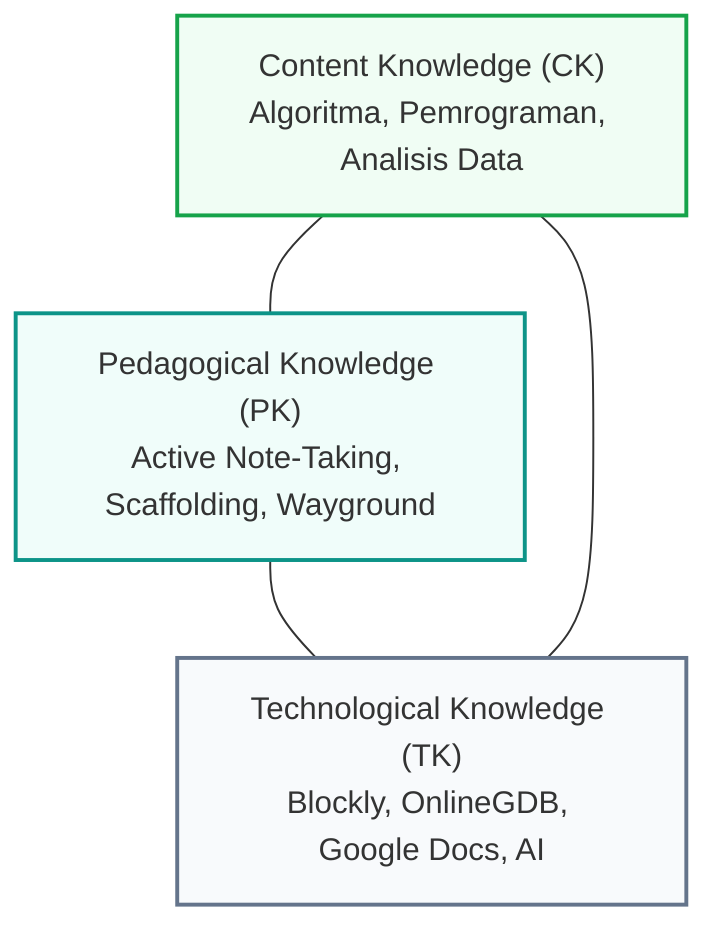

## 1. Rasional Pemilihan & Struktur Materi Esensial

Dalam pelaksanaan praktik mengajar mandiri PPL II di **SMK Negeri 3 Yogyakarta**, materi yang saya susun dan terapkan berfokus pada dua elemen krusial Capaian Pembelajaran (CP) Informatika Fase E untuk siswa **Kelas X TM 1** dan **Kelas X TM 2** (Teknik Mesin):

### A. Elemen Algoritma dan Pemrograman Dasar (Teori & Praktik)
Materi dirancang berjenjang dari pengenalan pola berpikir komputasional hingga penerjemahan algoritma ke dalam bahasa pemrograman fungsional:
1. **Dasar Berpikir Komputasional & Flowchart**: Mengenal algoritma sebagai urutan langkah logis penyelesaian masalah, simbol-simbol flowchart standar, dan penelusuran alur eksekusi (*dry-run tracing*).
2. **Struktur Logika Kendali**:
   - Struktur Runtunan (*Sequential Flow*).
   - Struktur Percabangan (*Selection/Conditional Branching: if, if-else*).
   - Struktur Perulangan (*Iteration/Looping: for, while*).
3. **Penerapan Praktik Coding Terpandu**:
   - Transisi visual melalui logika blok pada **Blockly Games**.
   - Penulisan kode sumber terstruktur pada IDE berbasis cloud (**OnlineGDB**).
   - Modifikasi logika program dan eksperimentasi berbantukan perangkat AI.

### B. Elemen Analisis Data (Kajian Teori Kontekstual)
1. **Hakikat Data & Informasi**: Memahami perbedaan data mentah, struktur data dasar (numerik, teks, kategoris), dan transformasi data menjadi wawasan yang bermakna.
2. **Pengumpulan & Validasi Data**: Teknik pencarian data digital yang kredibel, pemilahan informasi yang relevan, serta pengenalan dasar etika privasi data.
3. *Catatan Pelaksanaan*: Pada elemen Analisis Data, implementasi difokuskan pada penguasaan teori konsep, investigasi kelompok, dan penyusunan bahan presentasi karena masa penugasan PPL II di sekolah mitra telah memasuki akhir semester.

---

## 2. Relevansi Kontekstual dengan Jurusan Teknik Mesin (TM)

Tantangan utama mengajar materi komputasi pada siswa kejuruan non-TI adalah menghadirkan relevansi langsung (*meaningful learning*). Pada kelas **X TM 1 dan X TM 2**, saya mengontekstualisasikan materi materi ajar dengan karakteristik dunia teknik mesin:

- **Algoritma sebagai Standar Operasional Prosedur (SOP)**: Siswa teknik mesin sangat akrab dengan instruksi kerja mesin bubut, frais, dan keselamatan bengkel. Saya menganalogikan flowchart dan algoritma sebagai diagram alir SOP kerja mekanikal: satu langkah terlewat dapat menyebabkan kegagalan sistem.
- **Logika Percabangan pada Sistem Mekatronika/Sensor**: Struktur `if-else` dikorelasikan dengan sensor mesin industri (misal: *jika suhu oli > 80°C maka hentikan motor pompa*).
- **Presisi & Debugging**: Siswa diajak memahami bahwa menemukan kesalahan sintaks (*debugging*) mirip dengan mengukur toleransi mikrometer sekrup; ketelitian adalah kompetensi mutlak seorang teknisi.

---

## 3. Integrasi TPACK (Technological Pedagogical Content Knowledge)

Penyusunan materi mengedepankan integrasi tiga dimensi TPACK:
- **Content Knowledge (CK)**: Penguasaan konsep struktur algoritma pemrograman dan fondasi analisis data yang akurat, bebas dari kerancuan definisi teoritis.
- **Pedagogical Knowledge (PK)**: Penerapan metode *Active Note-Taking* di mana siswa menelusuri materi melalui internet dan wajib mencatatnya dengan kalimat mereka sendiri di buku tulis fisik guna merangsang proses kognitif pemahaman mendalam. Dilanjutkan validasi klasikal menggunakan slide PPT interaktif dan evaluasi formatif melalui kuis permainan **Wayground**.
- **Technological Knowledge (TK)**: Pemanfaatan platform web modern yang ringan tanpa membebani fasilitas lab komputer: **Google Docs** untuk transparansi rencana kegiatan belajar harian, **Blockly Games** sebagai media jembatan logika visual, **OnlineGDB** sebagai lingkungan pengembangan program (IDE) cloud instan, dan artikel digital rujukan serta panduan format ringkas (*cheatsheet PDF*).

---

## 4. Identifikasi & Antisipasi Miskonsepsi Pembelajaran

Dalam implementasi materi di kelas X TM 1 dan X TM 2, saya mengidentifikasi beberapa miskonsepsi umum dan menyiapkan strategi penanganannya:

| Potensi Miskonsepsi Siswa | Kenyataan Konsep Sebenarnya | Strategi Mitigasi yang Saya Terapkan |
| :--- | :--- | :--- |
| **"Belajar pemrograman adalah menghafal kode/sintaks bahasa tertentu."** | Pemrograman berfokus pada logika pemecahan masalah (*logic formulation*), sedangkan sintaks hanyalah media ekspresi bahasa. | Penggunaan **Blockly Games** terlebih dahulu agar siswa fokus menyusun logika blok perintah tanpa terbebani kesalahan tanda baca atau tanda kurung. |
| **"Boleh menyalin persis kalimat dari internet ke catatan."** | Menyalin tanpa mencerna tidak membangun struktur ingatan jangka panjang dan pemahaman konseptual. | Aturan ketat melarang *copy-paste*: siswa wajib membaca, memahami, dan menuliskan intisari menggunakan susunan bahasa mereka sendiri di buku catatan fisik. |
| **"Kecerdasan Artifisial (AI) dipakai untuk mengerjakan seluruh tugas koding."** | AI adalah asisten belajar untuk eksplorasi dan perbandingan alternatif solusi logika, bukan pengganti nalar mandiri. | Guru memberikan panduan (*cheatsheet*) terlebih dahulu, lalu mengarahkan penggunaan AI hanya pada fase modifikasi dan eksplorasi fitur tambahan. |
| **"Analisis data hanyalah rumus perhitungan angka."** | Analisis data mencakup penelusuran konteks, pemilahan sumber fakta, dan kemampuan mengomunikasikan temuan kepada orang lain. | Penugasan investigasi bertim yang bermuara pada pembuatan slide presentasi dan sesi tanya jawab terbuka antarkelompok. |

---

## 5. Bahan Bacaan & Tautan Perangkat Materi Ajar

- **Modul & Panduan Cheatsheet Algoritma Pemrograman** (Format ringkas PDF panduan sintaks dan logika pemrograman dasar).
- **Slide Presentasi Konfirmasi Guru** (Media PPT interaktif untuk validasi hasil riset mandiri siswa).
- **Repositori Bahan Bacaan Digital**: Kumpulan artikel pengantar analisis data dan algoritma komputasi untuk eksplorasi siswa di peramban.
- **Format Telaah Bahan Ajar**: Lembar verifikasi materi ajar bersama Guru Pamong Febriyana, S.T.
