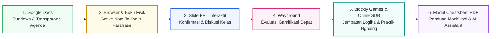

## 1. Arsitektur Ekosistem Media Pembelajaran

Pada pelaksanaan PPL II di **SMK Negeri 3 Yogyakarta**, keberhasilan pembelajaran di kelas **X TM 1 dan X TM 2** sangat ditentukan oleh pemilihan media yang tepat guna dan responsif terhadap karakteristik siswa. Menghindari kelemahan PPL I di mana siswa mudah terdistraksi saat membaca bahan tayang yang monoton, saya membangun sebuah **Ekosistem Media Multi-Modal Terpadu** yang mengombinasikan keunggulan platform digital modern dengan keandalan media konvensional.

---

## 2. Inventaris & Peran Spesifik Setiap Media

| No | Nama Media / Platform | Tipe Media | Peran Instruksional & Fungsi Pedagogis |
| :-: | :--- | :--- | :--- |
| **1** | **Google Docs** | *Cloud Document* | **Transparansi Agenda & Kontrak Belajar**: Ditampilkan saat apersepsi untuk menyajikan sasaran hari itu, langkah kegiatan, dan rundown menit ke menit sehingga siswa memiliki ekspektasi waktu yang terukur. |
| **2** | **Web Browser & Buku Tulis Fisik** | *Hybrid Digital-Manual* | **Active Note-Taking & Anti-Distraksi**: Siswa mencari materi teori melalui peramban, lalu wajib membaca, memahami, dan mencatatnya ke buku tulis masing-masing menggunakan kalimat sendiri (dilarang menyalin mentah-mentah). |
| **3** | **Slide PPT Guru** | *Visual Presentation* | **Validasi & Konfirmasi Konsep**: Digunakan guru di depan kelas untuk mengulas hasil pencarian mandiri siswa, meluruskan pemahaman yang keliru, serta memandu diskusi terbuka dua arah. |
| **4** | **Wayground** | *Gamified Quiz Platform* | **Evaluasi Formatif Interaktif**: Wadah asesmen cepat berupa kuis pilihan ganda interaktif dengan visual dan dinamika permainan yang sangat memacu antusiasme siswa teknik. |
| **5** | **Blockly Games** | *Visual Logic Puzzle* | **Jembatan Logika Algoritma**: Media permainan susun-blok interaktif untuk memperkuat nalar alur instruksi sekuensial dan percabangan sebelum siswa berhadapan dengan baris kode teks. |
| **6** | **OnlineGDB & Python** | *Cloud Web IDE* | **Eksekusi Koding Instan**: Lingkungan pengembangan kode terpadu berbasis peramban yang memungkinkan siswa menulis, mengompilasi, dan menguji program tanpa repot menginstal software lokal di laboratorium. |
| **7** | **Cheatsheet & Modul Praktikum PDF** | *Handout Digital Ringkas* | **Panduan Mandiri Siswa**: Lembaran ringkasan sintaks dasar, struktur perintah, dan contoh implementasi yang dapat diakses mandiri oleh siswa saat guru berkeliling mendampingi siswa lain. |
| **8** | **Generative AI Tools** | *AI Learning Assistant* | **Eksplorasi Tingkat Lanjut**: Digunakan secara terarah pada fase modifikasi kode untuk melatih siswa mengeksplorasi variasi algoritma dan memahami etika pemanfaatan AI. |

---

## 3. Analisis Efektivitas & Dampak terhadap Keterlibatan Siswa

### A. Pengentasan Pasivitas Melalui Kombinasi "Browser + Catatan Buku Fisik"
Pada evaluasi PPL I, penggunaan modul bacaan digital penuh sering kali disalahgunakan siswa untuk membuka tab gim atau aplikasi lain. Dengan mewajibkan siswa membaca di peramban lalu **menuliskan intisarinya dengan bahasa sendiri di buku catatan fisik**, proses kognitif tingkat tinggi (membaca, mencerna, memparafrase) terjadi secara nyata. Saat saya rutin berkeliling memeriksa buku catatan, siswa menunjukkan keseriusan penuh dan tidak ada lagi yang pasif membuka situs non-pelajaran.

### B. Ledakan Motivasi Siswa Melalui Gamifikasi "Wayground"
Platform **Wayground** terbukti menjadi media evaluasi paling favorit bagi siswa kelas X TM 1 dan X TM 2. Format penilaian yang menyerupai antarmuka game membuat siswa teknik mesin yang kompetitif merasa tertantang. Mereka terlibat aktif mendiskusikan skor, memeriksa kesalahan butir soal, dan secara sukarela meminta sesi penguatan untuk memperbaiki peringkat mereka.

### C. Efisiensi Teknis Lab Komputer Melalui "OnlineGDB" dan "Blockly Games"
Laboratorium komputer sekolah kejuruan sering menghadapi kendala lisensi atau variasi konfigurasi OS pada tiap PC. Penggunaan **Blockly Games** dan **OnlineGDB** memitigasi kendala infrastruktur tersebut secara tuntas karena keduanya berjalan 100% di peramban web (*zero-installation*). Transisi dari logika blok Blockly ke kode berbasis teks di OnlineGDB terbukti menurunkan tingkat kecemasan (*coding anxiety*) siswa pemula secara drastis.

---

## 4. Tantangan Teknis & Mitigasi di Laboratorium

- **Konektivitas Internet Fluktuatif**: Ketika koneksi lab mengalami perlambatan sesaat, materi cheatsheet PDF dan bahan bacaan artikel telah disiapkan dalam format berkas luring (*offline file share*) di jaringan lokal sekolah.
- **Perbedaan Kecepatan Belajar Siswa**: Bagi siswa yang selesai lebih cepat pada Blockly Games atau latihan dasar OnlineGDB, saya menyediakan tantangan pengayaan modifikasi kode berbantukan prompt AI terarah pada modul cheatsheet, sementara saya mendampingi siswa yang membutuhkan asistensi lebih (*scaffolding*).

---

## 5. Tautan & Repositori Media Pembelajaran

### A. Dokumen Google Docs Apersepsi & Rundown Harian Siswa
1. **Algoritma dan Pemrograman Dasar – Kelas X TM 1**: [Buka Google Docs X TM 1](https://docs.google.com/document/d/1lRHOsSIZXo_2Vfjg3wX_uaDwPwOShJvKxhwz8scbJu4/edit?usp=sharing)
   - Disajikan di awal sesi tatap muka: memuat sasaran pertemuan, daftar kata kunci pencarian materi mandiri, pembagian waktu mencatat, dan tautan tugas lab.
2. **Algoritma dan Pemrograman Dasar – Kelas X TM 2**: [Buka Google Docs X TM 2](https://docs.google.com/document/d/1_5u3GeEUt_sW9WYOk1gjVJv8cfObSW9GYa34HIzbV_I/edit?usp=sharing)
   - Panduan rundown operasional KBM untuk kelas X TM 2 pada topik logika algoritma, diagram alir, dan pengkodean Python.
3. **Analisis Data – Kelas X TM 1**: [Buka Google Docs X TM 1](https://docs.google.com/document/d/1oag8Qrmyf6o5QgBe_rMpnJKvSzQOlqZP5sw7KxVFN74/edit?usp=sharing)
   - Skenario penugasan investigasi kolaboratif, pembagian peran kelompok, serta panduan presentasi panel di depan kelas.
4. **Analisis Data – Kelas X TM 2**: [Buka Google Docs X TM 2](https://docs.google.com/document/d/1wC6qsrLVKBDcYSWvPO9ESDpO4uCSRFpcl85xDG4LOEQ/edit?usp=sharing)
   - Lembar skenario terpadu diskusi kelompok pengolahan data untuk kelas X TM 2.

### B. Media Interaktif & Cloud IDE Laboratorium
- **Evaluasi Gamifikasi**: [Platform Wayground](https://wayground.com) (Kuis interaktif pilihan ganda berbasis game yang membangkitkan kompetisi sehat siswa).
- **Penguatan Nalar Visual**: [Blockly Games](https://blockly.games) (Permainan logika alur blok sekuensial dan percabangan).
- **Laboratorium Koding Cloud**: [OnlineGDB IDE](https://www.onlinegdb.com) (Eksekusi dan debugging kode Python tanpa instalasi lokal).
- **Slide Presentasi Validasi**: Slide materi PPTX dapat diunduh pada daftar lampiran berkas fisik di atas.
