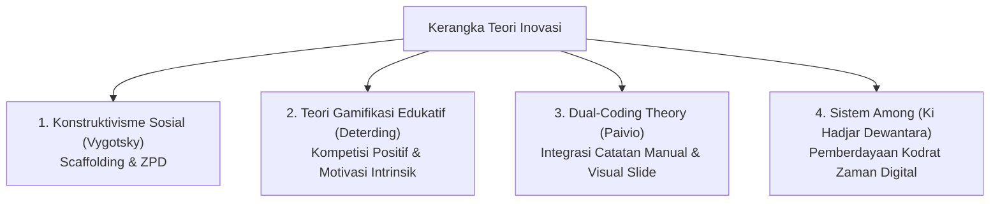
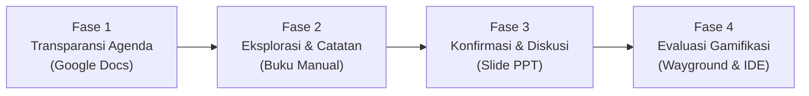

## 1. Latar Belakang & Identifikasi Tantangan Empiris

Mata kuliah **Seminar Pendidikan Profesi Guru (PPG)** menuntut calon pendidik profesional untuk tidak hanya terampil mengeksekusi pembelajaran di kelas, melainkan mampu merefleksikan, merumuskan, dan mempertanggungjawabkan karya inovasi pembelajaran yang berakar pada permasalahan riil di lapangan.

Berdasarkan pengalaman mengajar saya di SMK Negeri 3 Yogyakarta—baik pada fase terbimbing (PPL I) maupun praktik mandiri penuh di kelas X TM 1 dan X TM 2 (PPL II)—saya mengidentifikasi tiga anomali pedagogis utama dalam pembelajaran Informatika di sekolah kejuruan:
1. **Pasivitas Akibat Overload Teks**: Upaya menerapkan *In-Class Flipped Learning* dengan menyodorkan bahan bacaan digital panjang memicu kelelahan kognitif (*cognitive overload*). Siswa cenderung bosan, pasif, dan kehilangan motivasi.
2. **Distraksi Layar di Laboratorium Komputer**: Keberadaan komputer yang terhubung ke internet memicu *blind spot* pengawasan. Siswa rentan menyalahgunakan fasilitas untuk bermain game daring atau membuka media sosial ketika guru sedang mendampingi kelompok lain.
3. **Miskonsepsi Nalar Logika vs Sintaks Hafalan**: Siswa sering kali terjebak menghafal baris kode tanpa memahami struktur logika komputasional (*computational thinking*) yang mendasarinya.

Menjawab ketiga tantangan tersebut, saya merumuskan desain inovasi pembelajaran yang memadukan pendekatan **Guided Discovery**, tradisi penulisan manual **Active Note-Taking**, dan platform gamifikasi edukatif **Wayground**.

---

## 2. Landasan Teoretis & Kerangka Pedagogis (TPACK)

Desain inovasi ini dibangun di atas landasan teoretis yang kokoh dan berpihak pada murid:

- **Konstruktivisme Sosial & Scaffolding (Lev Vygotsky)**: Pengetahuan dibangun secara mandiri oleh peserta didik melalui penjelajahan terpandu. Guru hadir dalam *Zone of Proximal Development* (ZPD) memberikan panduan ringkas (*cheatsheet*), lalu perlahan melepas kemandirian siswa saat mereka mulai mahir.
- **Dual-Coding & Active Synthesis (Allan Paivio)**: Mengombinasikan pencatatan tulisan tangan dengan bahasa sendiri di buku fisik dan paparan slide visual PPT terbukti memperkuat retensi memori jangka panjang dibanding sekadar membaca teks digital di layar monitor (*anti copy-paste*).
- **Gamifikasi dalam TPACK**: Memanfaatkan **Wayground** sebagai instrumen evaluasi formatif yang dekat dengan kultur psikologis generasi muda, mengubah ketegangan ujian menjadi kompetisi interaktif yang menyenangkan.

---

## 3. Arsitektur Model: "4-Phase Active Synthesis Cycle"

Model inovasi pembelajaran yang saya rancang mengadopsi siklus empat fase terintegrasi:

### Rincian Eksekusi Tiap Fase:
1. **Fase 1: Transparansi Agenda (Google Docs)**:
   - Guru membuka kelas dengan membagikan dokumen agenda belajar satu halaman.
   - Siswa mengetahui persis urutan aktivitas, batas waktu pengerjaan, dan target kompetensi yang harus dicapai hari itu.
2. **Fase 2: Guided Discovery & Active Note-Taking (Peramban & Buku Fisik)**:
   - Siswa melakukan riset mandiri atau berkelompok berdasarkan kata kunci pemantik.
   - Siswa **wajib menyarikan pemahaman menggunakan bahasa sendiri di buku catatan fisik**, dilarang menyalin-tempel (*copy-paste*).
   - Guru melakukan keliling aktif (*active roaming & proximity control*) untuk memeriksa catatan dan membimbing siswa yang kesulitan.
3. **Fase 3: Konfirmasi Klasikal & Diskusi Terbuka (Slide PPT Interaktif)**:
   - Guru memvalidasi temuan siswa melalui presentasi visual PPT di depan kelas.
   - Meluruskan miskonsepsi logika algoritma dan membuka ruang tanya jawab demokratis.
4. **Fase 4: Evaluasi Formatif Cepat (Wayground & OnlineGDB)**:
   - Untuk materi teori: Evaluasi pilihan ganda berbasis gamifikasi menggunakan **Wayground** yang memberikan umpan balik skor instan.
   - Untuk materi praktik: Tantangan modifikasi koding pada cloud IDE **OnlineGDB** dengan panduan *cheatsheet* dan asistensi AI terarah.
   - Penutupan kelas dituntaskan dengan pengisian formulir refleksi metakognitif (*Exit Ticket*).

---

## 4. Analisis Bukti Efektivitas & Dampak Pembelajaran

Penerapan model inovasi ini sepanjang PPL II di kelas X TM 1 dan X TM 2 SMKN 3 Yogyakarta menghasilkan bukti empiris yang sangat memuaskan:
- **Ketuntasan Klasikal >88%**: Rata-rata nilai evaluasi formatif siswa melampaui Kriteria Ketercapaian Tujuan Pembelajaran (KKTP).
- **Respon Afektif 92% Positif**: Data *exit ticket* menunjukkan 92% siswa menyatakan lebih bersemangat, tidak merasa terbebani, dan lebih cepat memahami logika komputasi dibanding metode konvensional.
- **Efisiensi Setup Lab 100% Web-Based**: Seluruh platform (Google Docs, Wayground, OnlineGDB) berbasis cloud tanpa instalasi (*zero-installation*), mengeliminasi kendala teknis spesifikasi komputer sekolah.

---

## 5. Rencana Diseminasi & Gelar Karya Ilmiah

Sebagai luaran puncak dari mata kuliah Seminar PPG, karya inovasi ini akan disebarluaskan melalui tahapan:
1. **Penyusunan Artikel Ilmiah Best Practice**: Menulis naskah publikasi ilmiah bertema *"Peningkatan Nalar Komputasional Siswa SMK melalui Model Guided Discovery Berbantuan Wayground"* untuk diajukan ke prosiding seminar nasional pendidikan kejuruan.
2. **Pameran Gelar Karya Digital (E-Portfolio)**: Mendiseminasikan seluruh bukti modul ajar, rekaman video praktik, inovasi aplikasi SIBENKA/SIPENSI, dan instrumen asesmen melalui portal e-portfolio resmi ini di hadapan dewan penguji dan dosen pembimbing Universitas Negeri Yogyakarta.
3. **Diseminasi Komunitas MGMP Informatika**: Membagikan perangkat cheatsheet dan modul inovatif kepada rekan-rekan guru Informatika di forum Musyawarah Guru Mata Pelajaran (MGMP).

---

## 6. Berkas & Lampiran Proposal Seminar

- [Proposal Desain Inovasi Pembelajaran Lengkap (PDF)](/rpp.docx) (Naskah akademik inovasi model pembelajaran).
- [Modul Ajar & Panduan Ringkas Siswa (Cheatsheet)](/lkpd.docx) (Instrumen pendukung implementasi inovasi).
- Lembar Analisis Uji Coba Model & Rekapitulasi Data Exit Ticket.
- Draf Naskah Artikel Ilmiah / Best Practice Pembelajaran.
- Slide Presentasi Diseminasi Gelar Karya Seminar PPG UNY.

