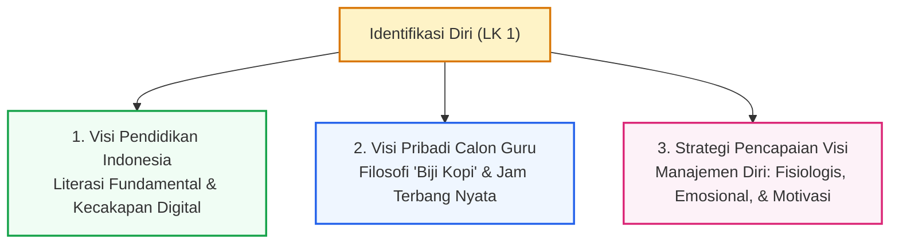
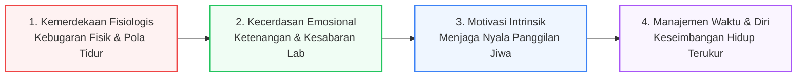

## 1. Konteks & Rasional Identifikasi Diri

Mata kuliah **Seminar Pendidikan Profesi Guru (PPG)** diawali dengan eksplorasi eksistensial mengenai siapa diri saya, apa nilai-nilai dasar yang saya anut, dan ke mana arah pengabdian saya sebagai seorang pendidik profesional. Menjadi guru bukan sekadar memilih pekerjaan teknis di depan papan tulis, melainkan sebuah komitmen moral (*calling*) untuk ikut serta mencerdaskan kehidupan bangsa.

Melalui **Lembar Kerja 1 (LK 1)**, saya merumuskan identifikasi diri secara jujur dan kritis, membedah tantangan nyata pendidikan di tanah air, serta menetapkan cetak biru (*blueprint*) pengembangan diri berkelanjutan.

---

## 2. Matriks Formulasi Visi & Langkah Pencapaian

| Indikator Evaluasi Diri | Pertanyaan Reflektif | Uraian Jawaban & Komitmen Personal |
| :--- | :--- | :--- |
| **Visi Pribadi untuk Pendidikan di Indonesia** | *Apa visi saya untuk pendidikan di Indonesia?* | **Mewujudkan pendidikan Indonesia yang unggul dalam literasi membaca dan digital, digerakkan oleh guru sebagai teladan yang ahli, berorientasi pada praktik nyata, dan mumpuni dalam menghadirkan pembelajaran kontekstual.** |
| **Visi Pribadi sebagai Calon Guru** | *Apa visi saya sebagai calon guru?* | **Menjadi pembelajar sepanjang hayat yang haus akan pengalaman dan 'jam terbang' melalui perpaduan teori dan praktik, demi mematangkan diri sebagai pendidik profesional yang berdampak nyata bagi sekolah, masyarakat, dan Indonesia.** |
| **Hal yang Dilakukan untuk Mencapai Visi** | *Apa yang akan saya lakukan untuk mencapai visi tersebut?* | **Mencapai visi pendidikan melalui manajemen diri yang utuh, yang berakar pada kemerdekaan fisiologis, kecerdasan emosional, dan pemeliharaan motivasi yang konsisten.** |

---

## 3. Penjabaran Komprehensif Visi Pendidikan Indonesia

### A. Fokus Mengatasi Darurat Literasi Membaca dan Digital
Keresahan utama terhadap lanskap pendidikan Indonesia saat ini berakar pada rendahnya kemampuan literasi dasar peserta didik, sebagaimana secara gamblang tercermin dari skor capaian tes PISA (*Programme for International Student Assessment*). Perbaikan mutu tidak dapat dimulai dari lapisan terluar, melainkan harus menyentuh fondasi paling esensial: **kemampuan membaca, menalar, dan memahami makna teks secara mendalam**.

Lebih dari itu, sejalan dengan disiplin keilmuan yang saya ampu sebagai calon guru **Informatika**, peningkatan literasi digital menjadi pilar penyokong yang mutlak tak terpisahkan. Peserta didik masa kini hidup dalam kepungan arus informasi instan. Mereka tidak boleh hanya menjadi konsumen pasif algoritma media sosial, melainkan wajib dibekali kemampuan teknis agar cerdas, kritis, beretika, dan cakap memproses serta memvalidasi data di ruang digital.

### B. Filosofi Guru sebagai "Biji Kopi" yang Ahli dan Praktisi Nyata
> *"Kualitas sebuah seduhan kopi sangat ditentukan oleh kualitas biji kopinya; begitu pula pendidikan yang mutlak bergantung pada kualitas guru."*

Sebagus apa pun kurikulum atau secanggih apa pun fasilitas sekolah, hasil akhirnya kembali pada kompetensi sang pendidik di dalam kelas. Seorang guru harus **tuntas dengan kompetensinya sendiri** dan wajib menjadi ahli dalam bidang keahlian yang diajarkannya sebelum mentransfer pengetahuan tersebut kepada orang lain.

Tuntutan ini terasa kian mendalam di lingkungan **Sekolah Menengah Kejuruan (SMK)** seperti SMK Negeri 3 Yogyakarta, yang mempersiapkan lulusan berorientasi kerja. Pengajaran kejuruan tidak boleh berhenti pada hafalan konsep di atas kertas. Sebagai guru informatika dan vokasi, saya dituntut mampu mendemonstrasikan, mempraktikkan, dan mencontohkan standar kerja industri secara riil di hadapan siswa.

### C. Pembelajaran yang Kontekstual dan Membumi
Ilmu pengetahuan kehilangan kekuatannya jika terisolasi dari realitas kehidupan. Guru yang cakap adalah guru yang adaptif dan mampu mengaitkan setiap topik pembelajaran dengan konteks lingkungan lokal, perkembangan teknologi kontemporer, serta kebutuhan hidup siswa sehari-hari. Pembelajaran kontekstual menjembatani jurang pemisah antara teori abstrak di ruang kelas dengan dinamika nyata di dunia kerja dan masyarakat, menjadikan setiap sesi belajar bermakna (*meaningful learning*).

---

## 4. Penjabaran Visi Pribadi Calon Guru

1. **Dedikasi sebagai Pembelajar Sepanjang Hayat (*Lifelong Learner*)**:
   Wisuda atau selesainya program PPG bukanlah garis akhir, melainkan titik awal pembelajaran yang sebenarnya. Perkembangan dunia teknologi informasi bergerak eksponensial. Menjadi guru berarti bersedia merendahkan hati untuk terus menjadi murid, terbuka menerima kritik, dan tekun mempelajari inovasi pedagogis baru.
2. **Mengukuhkan Pengetahuan Melalui Praktik dan Pengumpulan "Jam Terbang"**:
   Teori pedagogis yang cemerlang akan mandul tanpa keterampilan eksekusi lapangan yang matang. Tidak ada jalan pintas untuk membentuk intuisi mengajar selain terjun langsung ke dalam kelas sesering mungkin. Mengelola dinamika 36 siswa dengan latar belakang yang heterogen, menenangkan kelas yang jenuh, dan menyesuaikan ritme penjelasan di tempat menuntut ketahanan mental yang hanya bisa diasah melalui akumulasi jam terbang.
3. **Berkomitmen Penuh Menuju Profesionalisme Sejati**:
   Saya memandang profesi pendidik sebagai ladang dedikasi tertinggi. Profesionalisme bukan sekadar tentang pemenuhan jam kerja, melainkan kesungguhan merancang pembelajaran yang berpusat pada siswa (*student-centered*), ketelitian mengevaluasi hasil belajar, dan kejujuran menjaga integritas etika profesi.
4. **Memberikan Manfaat yang Meluas (*Social Impact*)**:
   Penguasaan teori dan kematangan praktik bermuara pada satu komitmen luhur: kebermanfaatan. Dedikasi ini dirancang berjenjang: dimulai dari memajukan ekosistem kelas dan sekolah tempat mengabdi, memberdayakan masyarakat sekitar, hingga berkontribusi nyata dalam mencerdaskan generasi penerus bangsa.

---

## 5. Strategi Manajemen Diri: Fondasi Pencapaian Visi

Menjadi pendidik profesional bukanlah perlombaan lari cepat (*sprint*), melainkan sebuah **lari maraton** yang membutuhkan stamina dan manajemen energi yang kokoh. Untuk mencapai visi besar di atas, saya merumuskan empat pilar manajemen diri:

1. **Mewujudkan Kemerdekaan Fisiologis**:
   Sebelum mampu mencurahkan perhatian optimal kepada peserta didik, guru harus mandiri secara fisik. Menjaga nutrisi seimbang, hidrasi cukup, pola istirahat teratur, dan kebugaran tubuh adalah syarat mutlak agar tidak mudah lelah ketika mengajar sesi praktik panjang di laboratorium komputer.
2. **Mengelola Kecerdasan Emosional Pribadi**:
   Di balik penguasaan silabus yang ketat, kunci sukses pengelolaan kelas kejuruan terletak pada kedewasaan emosi. Menghadapi siswa yang lambat memahami konsep koding atau mengalami kendala perilaku menuntut empati dan ketenangan. Guru yang emosinya stabil menciptakan lingkungan belajar yang aman secara psikologis (*psychologically safe classroom*).
3. **Memelihara Semangat dan Motivasi Intrinsik**:
   Rutinitas administrasi dan kelelahan fisik rentan memadamkan api semangat mengajar. Menjaga kesadaran akan alasan awal memilih profesi guru menjadi bahan bakar harian agar tetap antusias melayani peserta didik, baik pada tahap asistensi mengajar maupun saat memikul mandat penuh di kelas.
4. **Menerapkan Manajemen Pribadi yang Tangguh**:
   Seluruh pilar diikat oleh manajemen waktu yang disiplin. Mengalokasikan waktu untuk persiapan modul, koreksi tugas, pengembangan diri, dan kehidupan pribadi secara proporsional menghindarkan diri dari kejenuhan (*burnout*), memastikan langkah karier pendidik berlangsung sehat, berdaya tahan, dan produktif.
