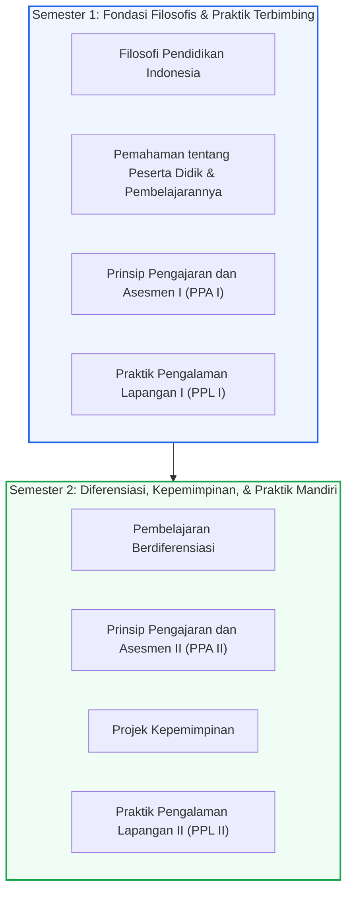

## 1. Orientasi & Cakupan Lembar Kerja 2

Pada **Lembar Kerja 2 (LK 2)** mata kuliah **Seminar Pendidikan Profesi Guru (PPG)**, mahasiswa melakukan rekonstruksi bermakna dan penarikan intisari pedagogis terhadap seluruh mata kuliah yang telah ditempuh selama dua semester perkuliahan di LPTK Universitas Negeri Yogyakarta.

Tujuan utama LK 2 adalah menghubungkan antara **fondasi teoretis** yang dipelajari di bangku perkuliahan dengan **realitas empiris** saat mengajar di sekolah mitra (SMKN 3 Yogyakarta).

> [!NOTE]
> **Status Dokumen**: Dokumen formal Lembar Kerja 2 (LK 2) saat ini sedang dalam proses konsolidasi akhir bersama Dosen Pembimbing Seminar PPG dan berkas otentik akan segera disematkan pada laman ini setelah tahap verifikasi selesai.

---

## 2. Struktur Pemetaan Mata Kuliah yang Ditelaah

### A. Mata Kuliah Semester 1
1. **Filosofi Pendidikan Indonesia**:
   - Menelaah pemikiran Ki Hadjar Dewantara mengenai konsep *menuntun*, sistem Among, kodrat alam, dan kodrat zaman.
   - Refleksi pergeseran paradigma mengajar dari yang berpusat pada pendidik (*teacher-centered*) menjadi pemerdekaan potensi siswa.
2. **Pemahaman tentang Peserta Didik dan Pembelajarannya**:
   - Membedah teori perkembangan kognitif, sosio-emosional, dan latar belakang sosio-kultural peserta didik rumpun kejuruan teknik.
   - Penerapan pendekatan *Teaching at the Right Level* (TaRL) dan *Culturally Responsive Teaching* (CRT).
3. **Prinsip Pengajaran dan Asesmen I (PPA I)**:
   - Penguasaan kerangka kerja *Understanding by Design* (UbD): menetapkan hasil yang diinginkan, bukti asesmen, dan rencana pembelajaran.
4. **Praktik Pengalaman Lapangan I (PPL I)**:
   - Pengalaman observasi orientasi sekolah, asistensi mengajar, dan praktik pembelajaran terbimbing di SMKN 3 Yogyakarta.

### B. Mata Kuliah Semester 2
1. **Pembelajaran Berdiferensiasi**:
   - Pemetaan kesiapan belajar (*readiness*), minat, dan profil belajar siswa kelas X Teknik Mesin.
   - Diferensiasi konten (bahan bacaan & slide), diferensiasi proses (pencarian mandiri & active roaming), dan diferensiasi produk (tugas coding & flowchart).
2. **Prinsip Pengajaran dan Asesmen II (PPA II)**:
   - Pendalaman asesmen autentik dan diagnostik untuk pembelajaran kejuruan berbasis kompetensi.
3. **Projek Kepemimpinan**:
   - Pengorganisasian inisiatif perubahan berbasis komunitas dan penguatan jiwa kepemimpinan guru di lingkungan sekolah.
4. **Praktik Pengalaman Lapangan II (PPL II)**:
   - Pelaksanaan praktik mengajar mandiri penuh di kelas X TM 1 & X TM 2, kegiatan nonmengajar piket 5S & KBM, serta pembuatan aplikasi SIBENKA dan SIPENSI.

---

## 3. Kerangka Refleksi Kritis (Metodologi ALACT / Gibbs)

Dalam menyusun telaah reflektif LK 2, analisis dilakukan menggunakan siklus refleksi terstruktur:
- **Action (Tindakan)**: Apa yang direncanakan dan dilakukan di kelas.
- **Looking Back (Menengok Kembali)**: Fakta apa yang sebenarnya terjadi selama proses KBM berlangsung.
- **Awareness of Essential Aspects (Menyadari Aspek Kunci)**: Faktor psikologis, teknis, atau pedagogis apa yang memicu keberhasilan atau kegagalan tindakan.
- **Creating Alternative Methods (Menciptakan Alternatif)**: Solusi perbaikan apa yang dapat dirumuskan untuk mengatasi kelemahan tersebut.
- **Trial (Pengujian)**: Penerapan solusi alternatif pada siklus pembelajaran berikutnya.
