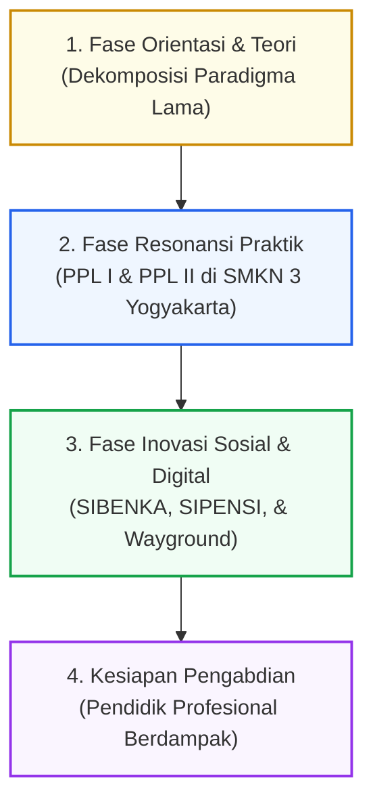

## 1. Orientasi & Rasional Refleksi Komprehensif

**Lembar Kerja 3 (LK 3)** pada mata kuliah **Seminar Pendidikan Profesi Guru (PPG)** berfungsi sebagai ruang perenungan holistik (*grand synthesis*) yang memadukan seluruh fragmen pengalaman belajar: dari orientasi awal, perkuliahan teoretis di kampus Universitas Negeri Yogyakarta, residensi sekolah mitra di SMK Negeri 3 Yogyakarta, hingga kesiapan berdiri mandiri sebagai guru profesional.

> [!NOTE]
> **Status Dokumen**: Lembar Kerja 3 (LK 3) saat ini berada dalam tahapan perumusan narasi akhir bersama Dosen Pembimbing Seminar PPG dan berkas dokumen resmi akan diunggah pada bagian ini segera setelah disahkan.

---

## 2. Peta Transformasi Menuju Pendidik Profesional

---

## 3. Pilar Sintesis Pengalaman Belajar Program PPG

### A. Pergeseran Mindset: Dari Pemilik Materi Menjadi Penuntun Potensi
Sebelum menempuh PPG, pengajaran sering dipahami secara sempit sebagai kegiatan mentransfer isi buku ke dalam kepala siswa. Melalui program ini, terjadi dekonstruksi mendasar:
- Guru bukan lagi satu-satunya sumber pengetahuan di era kecerdasan buatan dan internet.
- Peran esensial guru adalah menjadi fasilitator, kurator nalar kritis, dan penuntun tumbuhnya potensi unik (*kodrat alam*) setiap anak.

### B. Harmoni Budaya Ketarunaan dan Kehangatan Humanis di SMKN 3 Yogyakarta
Pengalaman residensi di SMK Negeri 3 Yogyakarta memberikan pelajaran mendalam tentang perpaduan disiplin industri dan kepedulian afektif:
- Budaya **Piket 5S** (Senyum, Sapa, Salam, Sopan, Santun) dan ketarunaan membangun ketertiban lahiriah yang kokoh.
- Namun, ketertiban tersebut hanya bermakna jika diimbangi dengan pendekatan humanis di dalam kelas: mendengarkan kesulitan siswa saat koding, memberikan bimbingan individual (*proximity control*), dan menghargai orisinalitas catatan buku masing-masing siswa.

### C. Dedikasi Ekosistem: Menjadi Bagian Solusi Sekolah
Program PPG membuktikan bahwa calon guru tidak boleh bersikap sebagai penonton pasif:
- Keberhasilan mengembangkan **SIPENSI** (sistem presensi web) dan **SIBENKA** (sistem manajemen bengkel) membuktikan bahwa kompetensi teknologi informatika dapat langsung disumbangkan untuk mengatasi permasalahan riil manajemen sekolah.
- Menjadi guru adalah tentang keterlibatan penuh dalam denyut nadi kehidupan sekolah: mulai dari upacara bendera, piket harian KBM, hingga kepanitiaan acara kemerdekaan dan kebugaran bersama.

---

## 4. Komitmen Pengabdian Pasca-PPG

Penyelesaian seluruh rangkaian perkuliahan dan praktik lapangan bermuara pada satu janji profesional:
1. **Menjadi Pendidik yang Adaptif**: Terus beradaptasi dengan lompatan teknologi (AI, cloud, otomasi) dan mengintegrasikannya secara etis ke dalam pembelajaran kejuruan.
2. **Menjaga Integritas Profesi**: Menjalankan amanah pengajaran dengan penuh keikhlasan, menjunjung tinggi kode etik guru, dan memprioritaskan kepentingan masa depan peserta didik.
3. **Mendedikasikan Diri untuk Kemajuan Bangsa**: Mengabdi di garis terdepan pendidikan vokasi demi melahirkan generasi muda Indonesia yang berkarakter kuat, cerdas, dan siap bersaing di kancah global.
