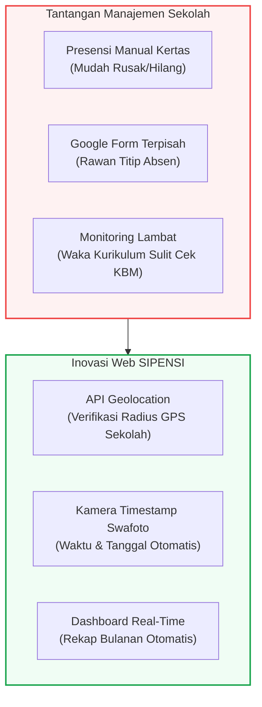
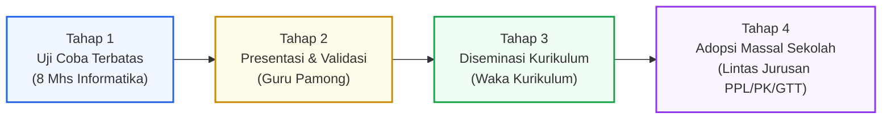

## 1. Identitas Karya Inovatif

Mata kuliah **Seminar Pendidikan Profesi Guru (PPG)** menuntut mahasiswa calon guru untuk tidak sekadar menguasai ruang kelas, tetapi juga mampu menghadirkan terobosan nyata (*educational innovation*) guna menyelesaikan kendala manajerial maupun instruksional di sekolah mitra.

Melalui **Lembar Kerja 4 (LK 4)**, saya merancang dan mengimplementasikan sebuah sistem administrasi presensi digital modern yang diberi nama **SIPENSI**:

- **Nama Karya**: *Aplikasi Presensi Berbasis Web dengan Fitur Geolocation dan Timestamp Swafoto (SIPENSI)*
- **Sasaran Pengguna**: Mahasiswa Praktik Pengalaman Lapangan (PPL), Mahasiswa Praktik Kependidikan (PK), dan Guru Tidak Tetap (GTT) di **SMK Negeri 3 Yogyakarta**.
- **Konteks Lembaga**: Sekolah Menengah Kejuruan berorientasi ketarunaan dengan mobilitas tinggi dan dinamika KBM bengkel yang padat.

---

## 2. Identifikasi Kebutuhan & Akar Masalah Lapangan

Berdasarkan pengamatan empiris saya selama menjalankan penugasan PPL II di **SMK Negeri 3 Yogyakarta**, kelancaran proses pembelajaran di kelas dan bengkel praktik sangat bergantung pada ketepatan waktu serta kedisiplinan para tenaga pendidik (khususnya mahasiswa PPL, PK, dan GTT).

Namun, ditemukan beberapa titik rawan manajerial yang menghambat operasional sekolah:
1. **Sistem Presensi Masih Manual**: Presensi kedatangan harian masih menggunakan lembaran kertas fisik yang rentan tercecer, robek, atau dimanipulasi data kehadirannya.
2. **Fragmentasi Data Piket KBM**: Untuk pelaporan tugas Piket Kegiatan Belajar Mengajar (KBM), digunakan instrumen *Google Form* terpisah yang tidak terhubung dengan absensi gerbang harian. Sistem ini rawan praktik "titip absen" karena siapa pun dapat mengisi tautan dari luar lingkungan sekolah.
3. **Kendala Monitoring Real-Time**: Guru Pamong dan Wakil Kepala Sekolah Bidang Kurikulum (Waka Kurikulum) kesulitan memantau kesiapan pengajar di kelas secara tepat waktu.
4. **Lambatnya Rekapitulasi Data**: Rekapitulasi presensi bulanan membutuhkan waktu berhari-hari karena staf harus memeriksa lembaran kertas dan spreadsheet secara manual satu per satu, berpotensi mengganggu efektivitas evaluasi KBM.

---

## 3. Gagasan Inovasi & Arsitektur Solusi Teknis

Menjawab permasalahan di atas, saya merumuskan ide untuk mendigitalkan dan memusatkan sistem manajemen kehadiran tersebut melalui rancang bangun **Aplikasi Presensi Berbasis Web Terintegrasi**.

### A. Fitur Unggulan Sistem
- **Verifikasi Koordinat Geolocation API**: Memanfaatkan *HTML5 Geolocation API* pada gawai pengguna untuk mengunci koordinat GPS saat presensi dilakukan. Sistem hanya mengizinkan pengiriman kehadiran jika koordinat berada di dalam radius resmi wilayah SMKN 3 Yogyakarta.
- **Kamera Swafoto dengan Watermark Timestamp Otomatis**: Khusus untuk bukti kehadiran Piket KBM, pengguna wajib mengunggah foto diri (*selfie*) langsung melalui kamera gawai yang otomatis dibubuhi tanda air digital (tanggal, jam, menit, detik) tanpa celah manipulasi unggahan galeri lawas.
- **Sistem Peran Ganda (Dual-Role Architecture)**:
  - *Role Mahasiswa/GTT*: Antarmuka simpel untuk login, penekanan tombol hadir instan, perekaman GPS otomatis, dan pelaporan piket harian.
  - *Role Guru Pamong / Admin / Waka Kurikulum*: Dashboard pemantau kehadiran *real-time*, verifikasi bukti swafoto, serta fitur ekspor laporan bulanan otomatis sekali klik.

---

## 4. Pembuktian 5 Prinsip Karya Inovasi Pendidikan

Karya inovasi ini dirancang dengan memenuhi 5 prinsip utama inovasi pendidikan yang ditetapkan dalam kriteria kelulusan profesi:

| No | Prinsip Inovasi | Penjelasan & Bukti Penerapan Lapangan |
| :-: | :--- | :--- |
| **1** | **Kebaruan (*Novelty*)** | Mengintegrasikan presensi harian gerbang dan piket KBM yang sebelumnya terpecah (kertas & Google Form) ke dalam satu portal terpusat mandiri yang dirancang khusus bagi SMKN 3 Yogyakarta. |
| **2** | **Kreativitas (*Creativity*)** | Mengombinasikan teknologi *web geolocation* dan *timestamp camera* sebagai solusi pengawasan jarak jauh yang berbiaya murah, ramah sumber daya, dan mudah diakses melalui ponsel masing-masing pengguna tanpa perangkat keras mahal. |
| **3** | **Kebermanfaatan (*Usefulness*)** | Memberikan nilai tambah nyata bagi Waka Kurikulum dan Guru Pamong dalam efisiensi rekapitulasi data, eliminasi human-error, dan optimalisasi monitoring kesiapan SDM di ruang kelas. |
| **4** | **Relevansi & Kontekstualitas** | Selaras dengan agenda transformasi digital sekolah vokasi modern dan budaya ketarunaan SMKN 3 Yogyakarta yang menjunjung tinggi kedisiplinan dan transparansi. |
| **5** | **Efektivitas Terbukti (*Evidence-Based*)** | Teruji di lapangan secara nyata: terbukti meniadakan kasus manipulasi presensi dan secara resmi diminta oleh pihak sekolah untuk diadopsi massal lintas jurusan. |

---

## 5. Rute Implementasi Bertahap (Iterative Staged Rollout)

Pengembangan dan penerapan aplikasi ini dilakukan melalui metodologi adaptif dan bertahap guna memastikan kestabilan sistem:

1. **Tahap 1 (Uji Coba Skala Kecil)**: Diluncurkan pada kelompok terbatas yang terdiri dari 8 mahasiswa PPL jurusan Informatika untuk menguji akurasi GPS dan responsivitas antarmuka.
2. **Tahap 2 (Validasi Guru Pamong)**: Mempresentasikan rekapitulasi data dan demonstrasi fitur anti-kecurangan kepada Guru Pamong.
3. **Tahap 3 (Eskalasi Manajemen Kurikulum)**: Melaporkan efektivitas sistem kepada Waka Kurikulum SMKN 3 Yogyakarta untuk mendapatkan arahan standardisasi operasional.
4. **Tahap 4 (Adopsi Massal Lintas Jurusan)**: Pihak sekolah mendaftarkan seluruh akun mahasiswa PPL, Praktik Kependidikan (PK), dan Guru Tidak Tetap (GTT) dari seluruh program keahlian untuk menggunakan sistem SIPENSI secara resmi.

---

## 6. Metrik Evaluasi & Dampak Keberhasilan

Efektivitas produk inovasi ini diukur melalui tiga indikator kinerja utama:
- **Validitas Data Kehadiran**: Peningkatan akurasi data mencapai tingkat tertinggi. Kasus keterlambatan tersembunyi dan titip presensi berhasil dieliminasi karena penguncian koordinat *geolocation* sekolah.
- **Efisiensi Waktu Rekapitulasi**: Waktu kerja penyusunan laporan presensi bulanan yang semula memakan waktu 3–5 hari kerja kini terpangkas menjadi hitungan detik dengan fitur cetak otomatis dari database.
- **Tingkat Kepuasan & Umpan Balik Positif**: Wawancara dengan pemangku kepentingan (Waka Kurikulum dan Guru Pamong) mencatatkan tingkat kepuasan tinggi terhadap kemudahan operasional dan transparansi pemantauan tenaga pendidik.
