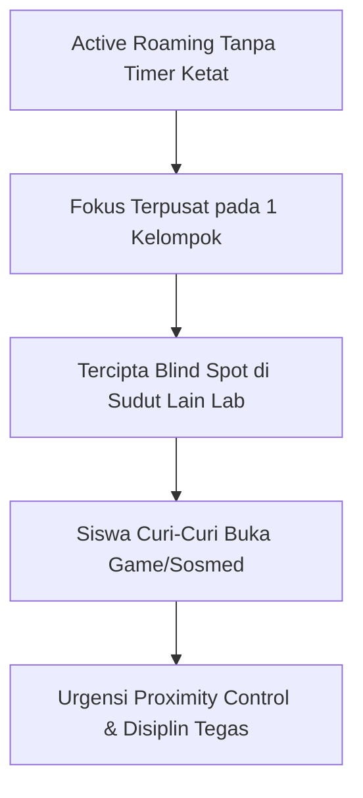

## 1. Identitas & Sasaran Pembelajaran Siklus 2

Melanjutkan perbaikan dari evaluasi Siklus 1, praktik mengajar terbimbing Siklus 2 berfokus pada penguatan pengelolaan kelas dan interaksi instruksional:
- **Satuan Pendidikan**: SMK Negeri 3 Yogyakarta
- **Mata Pelajaran**: Informatika (Fase E / Kelas X)
- **Elemen / Topik**: Jaringan Komputer dan Internet (Topologi Jaringan & Perancangan Logis)
- **Model Pembelajaran**: *Problem-Based Learning* (PBL) Berbantuan Media Visual Interaktif
- **Guru Pamong (GP)**: Ibu **Febriyana, S.T.**

Tujuan pembelajaran siklus ini adalah melatih siswa mengidentifikasi topologi jaringan fisik dan logis yang relevan dengan kebutuhan industri kejuruan serta merancang denah jaringan komputer sederhana.

---

## 2. Dinamika Pembelajaran & Munculnya Tantangan "Blind Spot"

Merespons evaluasi siklus sebelumnya, saya menerapkan strategi pendampingan individu dan kelompok secara aktif (*individual scaffolding & active roaming*). Saya berkeliling antar-meja komputer untuk membimbing siswa yang mengalami hambatan logika.

Namun, strategi baru ini memunculkan tantangan baru yang tidak terduga:
- **Munculnya Titik Buta Pengawasan (*Blind Spot*)**: Ketika saya mencurahkan perhatian mendalam untuk membantu satu kelompok di sudut ruangan, beberapa siswa di sudut lain memanfaatkan kelengahan tersebut untuk membuka peramban lain, bermain game daring, atau mengakses media sosial.
- **Dilema Alokasi Waktu**: Terlalu lama berhenti di satu meja menyebabkan kelompok lain merasa terabaikan dan kehilangan momentum fokus belajar.

---

## 3. Penegakan Disiplin Kelas yang Humanis

Menyadari adanya pelanggaran tata tertib laboratorium, saya mengambil tindakan tegas dengan menghentikan aktivitas kelas sejenak, menegur siswa yang bersangkutan, dan mencatat nama mereka pada lembar observasi harian. Tindakan ini terbukti efektif mengembalikan konsentrasi kelas hingga jam pelajaran usai.

Dalam sesi supervisi, Guru Pamong Ibu **Febriyana, S.T.** memberikan apresiasi sekaligus catatan etika pedagogis yang sangat membekas bagi saya:
> *"Ketegasan seorang guru adalah benteng kedisiplinan kelas, Mas Yodi. Namun ingat, tegakkan aturan dengan penuh kehati-hatian. Jangan pernah mempermalukan atau mengerdilkan mental murid di hadapan teman-temannya. Panggil dan ingatkan dengan empati—tunjukkan bahwa kita menegur karena peduli pada masa depan mereka."*

Nasihat ini selaras dengan prinsip **Sistem Among Ki Hadjar Dewantara**: menuntun dan menjaga kodrat anak dengan keteladanan dan kasih sayang tanpa merusak rasa percaya diri mereka.

---

## 4. Evaluasi Kinerja Praktik Mengajar (Lampiran 8: Skor 3.9)

Pelaksanaan pembelajaran pada Siklus 2 ini menjadi salah satu dasar penilaian resmi praktik mengajar terbimbing pada **Lampiran 8** Direktorat PPG Kemendikdasmen:
- **Penguasaan Materi & Apersepsi**: Mendapatkan skor maksimal **4.0** dari Guru Pamong karena keberhasilan mengaitkan topologi jaringan dengan alur kabel di bengkel teknik.
- **Faktor Penunjang & Manajemen Waktu**: Mendapatkan skor **3.6** dengan catatan bahwa pengorganisasian waktu antar-fase kegiatan masih perlu ditingkatkan agar bagian penutup tidak terburu-buru.
- **Total Skor Kumulatif**: **78 (Rata-rata 3.9 / 4.0 - Kategori Istimewa)**.

---

## 5. Rencana Perbaikan Menuju Siklus 3

Dari pengalaman Siklus 2, dua rencana strategis dirumuskan:
1. **Penerapan Timer Kegiatan**: Menggunakan penghitung waktu digital di layar proyektor utama agar siswa memiliki kesadaran waktu (*time awareness*) dalam menyelesaikan tiap tahapan tugas.
2. **Penyusunan Skenario Cadangan (*Plan B*)**: Merumuskan modul ajar yang memiliki skenario alternatif jika terjadi kendala teknis jaringan atau ketimpangan kecepatan kerja antar-peserta didik.

---

## 6. Berkas & Lampiran Pembelajaran Siklus 2

- [Modul Ajar / RPP Siklus 2 Topologi Jaringan](/rpp.docx) (Perangkat pembelajaran berbasis problem solving).
- [Lembar Kerja Peserta Didik (LKPD) Siklus 2](/lkpd.docx) (Panduan desain topologi jaringan lab).
- Lembar Observasi Kinerja Mengajar Lampiran 8 (Skor 3.9 oleh Febriyana, S.T.).
- Lembar Evaluasi Disiplin Laboratorium Komputer SMKN 3 Yogyakarta.
