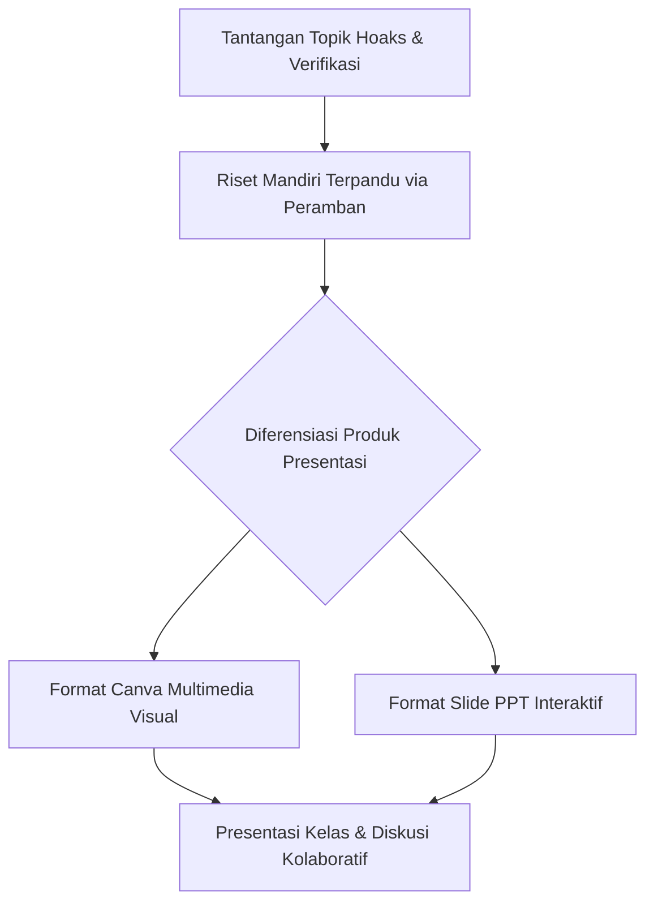

## 1. Identitas & Capaian Pembelajaran Siklus 3

Praktik Pembelajaran Terbimbing Siklus 3 merupakan puncak konsolidasi keterampilan pedagogis saya selama menempuh PPL I:
- **Satuan Pendidikan**: SMK Negeri 3 Yogyakarta
- **Mata Pelajaran**: Informatika (Fase E / Kelas X)
- **Elemen / Topik**: Dampak Sosial Informatika & Literasi Digital (*"Mengkaji Kritis Informasi Media Sosial dan Fenomena Hoaks"*)
- **Pendekatan**: Pembelajaran Berdiferensiasi Produk & Riset Mandiri Terpandu (*Guided Web-Research*)
- **Guru Pamong (GP)**: Ibu **Febriyana, S.T.**

Tujuan pembelajaran siklus ini adalah membekali siswa kejuruan dengan daya nalar kritis dalam menganalisis validitas informasi digital, membedakan fakta dan hoaks, serta memproduksi konten edukatif digital secara kreatif.

---

## 2. Inovasi Metode: Riset Mandiri Terpandu & Diferensiasi Produk

Belajar dari evaluasi Siklus 1 (siswa pasif jika disodori teks panjang) dan Siklus 2 (perlunya instruksi terstruktur anti-distraksi), pada Siklus 3 saya menerapkan dua terobosan utama:

1. **Riset Mandiri Terpandu (*Guided Web-Research*)**: Siswa tidak lagi dijejali bahan bacaan pasif, melainkan diberikan lembar panduan kata kunci (*keyword prompt*) untuk mencari, membedah, dan memverifikasi contoh kasus hoaks riil yang beredar di internet menggunakan peramban komputer masing-masing.
2. **Diferensiasi Produk Presentasi**: Saya memberikan kemerdekaan belajar (*student agency*) dalam memilih media pelaporan hasil analisis. Siswa yang berminat pada desain grafis memilih menggunakan **Canva**, sementara siswa yang menyukai struktur teks teratur memilih menggunakan **PowerPoint (PPT)**.

---

## 3. Dinamika Keberhasilan & Lonjakan Antusiasme Siswa

Pemberian otonomi belajar ini memicu lonjakan antusiasme yang sangat signifikan:
- **Partisipasi Aktif 100%**: Tidak ada lagi siswa yang pasif atau mengantuk. Seluruh siswa sibuk berdiskusi membedah kasus hoaks dan mendesain slide presentasi mereka secara antusias.
- **Kualitas Presentasi Beragam & Kreatif**: Perbedaan produk Canva dan PPT memperkaya wawasan visual kelas saat sesi presentasi kelompok berlangsung.
- **Hubungan Emosional yang Positif**: Jarak psikologis antara guru praktikan dan siswa telah sepenuhnya mencair menjadi hubungan saling menghargai dan kooperatif.

---

## 4. Evaluasi Kritis: Urgensi Sesi Konfirmasi Klasikal

Meskipun aktivitas kelas berjalan sangat hidup, evaluasi reflektif menemukan satu aspek perbaikan yang esensial:
- **Risiko Miskonsepsi Tanpa Konfirmasi**: Kebebasan riset di internet terkadang membawa siswa pada kesimpulan yang bias jika tidak dipandu secara seksama.
- **Rencana Solusi**: Guru wajib menyisipkan **Sesi Konfirmasi & Validasi Klasikal** tepat setelah riset mandiri usai dan sebelum presentasi akhir dimulai. Sesi ini krusial untuk menyamakan persepsi kebenaran konsep, meluruskan kekeliruan nalar, dan mengikat intisari materi secara formal.

---

## 5. Sintesis Capaian Akhir PPL Terbimbing Menuju PPL II

Siklus 3 menandai tuntasnya fase PPL I Terbimbing di SMK Negeri 3 Yogyakarta dengan legalitas penilaian resmi dari Guru Pamong Ibu Febriyana, S.T.:
- **Nilai Perangkat Pembelajaran (Lampiran 7)**: Skor **68 (Rata-rata 3.4 / 4.0 - Amat Baik)**.
- **Nilai Pelaksanaan Pembelajaran (Lampiran 8)**: Skor **78 (Rata-rata 3.9 / 4.0 - Istimewa)**.

Pengalaman berharga dalam mengelola Siklus 1, 2, dan 3 ini menjadi fondasi kokoh bagi saya untuk merancang model pembelajaran mandiri yang lebih berbobot (yaitu *Guided Discovery & Active Note-Taking*) pada mata kuliah **PPL II** selanjutnya.

---

## 6. Berkas & Lampiran Pembelajaran Siklus 3

- [Modul Ajar / RPP Siklus 3 Literasi Media Digital](/dokumen/ppl-1/rpp-ppl1.docx) (Perangkat pembelajaran berdiferensiasi produk).
- [Lembar Kerja Peserta Didik (LKPD) Siklus 3](/dokumen/ppl-1/lkpd-ppl1.docx) (Panduan verifikasi fakta dan hoaks).
- Rubrik Penilaian Produk Presentasi Canva & PPT.
- Salinan Berkas Resmi Penilaian Lampiran 7 & Lampiran 8 (Diterbitkan 30 April 2026).
